## Touhidur Rahman · php, laravel, and the parts underneath

PHP since before Laravel existed, Laravel since version 3. Fifteen years in. Most of what
I enjoy is in systems that are already running and can't break while you improve them.

```
$ whoami
touhidur · php + laravel + vue + react + node · 15 yrs in

$ what
ojs core (2022-2026) · multi-tenant saas · 15 packages on packagist

$ status
open to senior, lead and full-stack roles · remote · full-time or contract
```

### highlights

- [Top 10 all-time contributor](https://github.com/pkp/ojs/graphs/contributors?all=1) to
  [**Open Journal Systems**](https://github.com/pkp/ojs), the publishing platform behind
  58,000+ journals in 156 countries. Four years on the core team at PKP, mostly bringing
  Laravel's internals into an application that isn't a Laravel app. Across PKP's repos:
  1,300+ merged commits, 1,000+ pull requests, 150+ reviews.
- Maintain [**15 Laravel packages**](https://packagist.org/packages/touhidurabir/) with
  195k+ combined installs. `laravel-model-sanitize` was
  [featured on Laravel News](https://laravel-news.com/laravel-model-sanitize).
- Lead architect on [**Dentall Manager**](https://dentallmanager.nl/), a multi-tenant
  Laravel and Vue SaaS on database-per-tenant isolation. 100% uptime since launch.
- Leading engineering teams since 2017, up to 12 people, across 80+ client projects.
- Not only PHP. React and TypeScript front ends, Node.js and Go services, Ruby on Rails apps,
  shipped on AWS with Docker.
- Claude and GitHub Copilot in the loop every day, for writing code and for reviewing it.
  I still read every diff.
- Certified Laravel Developer.

### stack

| | |
|---|---|
| **backend** |      |
| **frontend** |     |
| **data** |    |
| **cloud & ops** |      |
| **ai-assisted dev** |   |

<p>
  <picture>
    <source media="(prefers-color-scheme: dark)" srcset="./profile/stats-dark.svg">
    
  </picture>
</p>

### elsewhere

[touhidurabir.github.io](https://touhidurabir.github.io/) ·
[résumé (pdf)](https://touhidurabir.github.io/files/Touhidur_Rahman_Resume.pdf) ·
[packagist](https://packagist.org/packages/touhidurabir/) ·
[linkedin](https://www.linkedin.com/in/touhidur) ·
abircse06@gmail.com

Husband, father, documentary series lover. Currently learning Rust, slowly.
